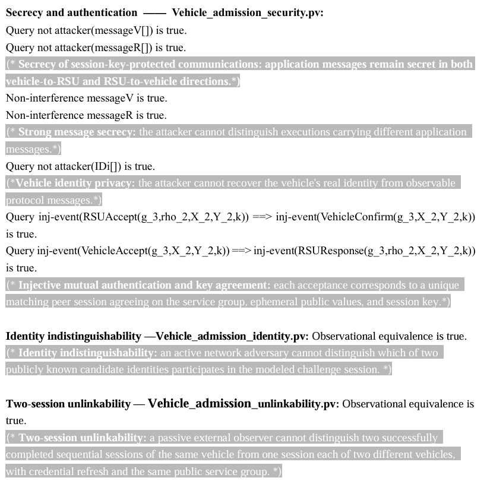

# Supplementary Material

This repository provides supplementary materials for **Scalable Edge-Autonomous Vehicle Admission with Reversible Revocation**.

## ProVerif Models

- [Security model](./Vehicle_admission_Security.pv): Application-message secrecy, identity confidentiality, and mutual authentication.
- [Identity indistinguishability model](./Vehicle_admission_identity.pv): Single-session identity indistinguishability against an active network adversary.
- [Unlinkability model](./Vehicle_admission_unlinkability.pv): Two-session unlinkability against a passive external observer, comparing two successfully completed sessions of the same vehicle with one session each of two different vehicles.

The equivalence models assume uncompromised secrets and that the vehicles remain authorized for the same service group. They do not model vehicle-memory disclosure or network-level tracking. The unlinkability model explicitly carries the refreshed credential into the next session.

## ProVerif Verification Summary

